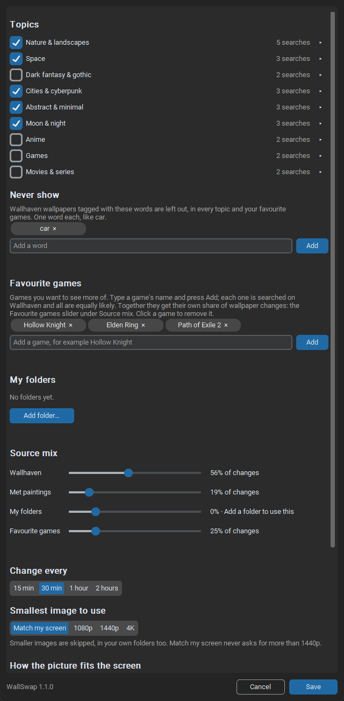
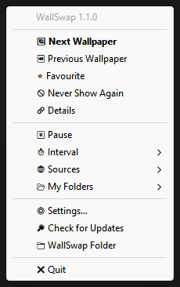

# WallSwap

Small Windows tray app that changes my wallpaper (and lock screen) every 30 minutes. I got tired of looking at the same background, so this pulls from a few places:

- [Wallhaven](https://wallhaven.cc) searches on topics you pick: scenery, space, cities, night skies, dark fantasy, games, anime and so on. SFW only, and low-rated stuff is skipped.
- Wallpapers for your favourite games, if you add any (mine is Path of Exile)
- Public-domain paintings from [the Met's open access API](https://metmuseum.github.io/)
- Your own folders of screenshots or wallpapers

Everything is landscape and at least as big as your screen (your biggest one, if you have several). Matching the screen never asks for more than 2560x1440, so a 4K screen still gets 1440p images; pick 1080p, 1440p or 4K yourself if you'd rather. It doesn't repeat images, and it won't change the wallpaper while a fullscreen game is running, unless you switch that off (it catches up within a minute of you leaving the game, and does the same if a download fails because you're offline). No API keys needed.

## Installing it

Windows 10/11, no Python needed. Both downloads are on the [Releases page](https://github.com/allenliou12/Wall-Swap/releases/latest).

- **Installer (recommended):** run `WallSwap-Setup.exe`. It installs just for you (no admin prompt) into `AppData\Local\Programs\WallSwap`, and adds WallSwap to the Start menu. Two boxes, both ticked to start with, add a desktop shortcut and start WallSwap when you sign in (the same as the Start with Windows switch, which you can turn off later). Uninstall it from Settings → Apps like anything else. Installing a newer version over it upgrades in place.
- **Portable zip:** unzip `WallSwap-<version>.zip` somewhere that will stay put (for example `Documents\WallSwap`) and run `WallSwap.exe`. Keep the `_internal` folder next to it.

Neither is code-signed, so Windows SmartScreen may say "Windows protected your PC" the first time. Click **More info**, then **Run anyway**. If you'd rather not, run it from source as shown below.

Start with Windows is also the switch in the settings window. Its shortcut points at wherever `WallSwap.exe` is, so if you move the portable folder, turn the switch off and on again. If you already had Start with Windows on from an older copy (say, one run from source), the installed or portable exe takes that shortcut over the first time it runs. Uninstalling removes that shortcut too, but never touches `Pictures\WallSwap` (your settings, favourites and downloads); delete that folder yourself if you want them gone.

## Running it from source

Windows 10/11, Python 3.13+.

```
uv sync
uv run wallpaper_changer.py
```

Or with pip:

```
pip install pystray Pillow requests customtkinter winrt-runtime winrt-windows-foundation winrt-windows-storage winrt-windows-system-userprofile
python wallpaper_changer.py
```

The `winrt` packages are only for the lock screen; without them it just does the desktop.

To build the exe, the zip and the installer yourself (the installer needs [Inno Setup 6](https://jrsoftware.org/isinfo.php): `winget install --id JRSoftware.InnoSetup -e --scope user`):

```
uv sync
powershell -ExecutionPolicy Bypass -File build.ps1
```

That makes `dist\WallSwap\WallSwap.exe`, `dist\WallSwap-<version>.zip` and `dist\WallSwap-Setup.exe`. For just the exe, run `uv run pyinstaller --noconfirm WallSwap.spec`.

The first time it runs, the settings window opens so you can pick what you want. The first wallpaper changes straight away with the starter mix while you look around.

## Settings window

Right-click the tray icon and pick Settings… to open it again.



- **Topics:** tick the ones you want. Click a topic's arrow to see its searches; click a search to remove it, or type your own and press Add. Only ticked topics are searched, and every search in them is equally likely.
- **Never show:** words to keep out of Wallhaven results, in every topic and your favourite games. One word each (like `car`), up to 10. Met paintings and your own folders aren't affected.
- **Favourite games:** games you want to see more of. Type a game's name and press Add; add as many as you like (a sequel is just another one). Each is searched on Wallhaven, all are equally likely, and together they have their own slider in the source mix. Leave the list empty if you don't want any. There aren't many game wallpapers, so once they've all been shown, that share uses the game folders instead.
- **My folders:** add or remove your own image folders. Only images directly in a folder are used, not subfolders, and WallSwap never changes anything in them.
- **Source mix:** one slider each for Wallhaven, Met paintings, your folders and your favourite games. The percentage next to each is its real share of changes. A source with nothing to use (no folders, no game searches, no ticked topics) or turned off drops out and says why. Reset puts the four sliders back to the defaults.
- **Change every:** 15 min, 30 min, 1 hour or 2 hours. With "Wait while a fullscreen game is in front" on (the default) a change that comes due during a game waits until you leave it; turn it off to keep changing regardless.
- **Smallest image to use:** Match my screen, 1080p, 1440p or 4K. Smaller images are skipped, in your own folders too.
- **How the picture fits the screen:** As Windows has it (the default: WallSwap doesn't touch it), Fill, Fit or Span. Span stretches one picture across all your screens.
- **Download on metered connections:** off by default. On a phone hotspot or a capped or roaming plan (anything Windows marks as metered) WallSwap downloads nothing and uses only your own folders; with no folders the wallpaper just stays until you're back on a normal connection. The update check waits too.
- **Updates:** once a day (and at start) WallSwap asks GitHub whether a newer version is out and tells you once per version. It only reads the public release page, sends nothing about you, and never downloads or installs anything. Turn the switch off to stop it; Check for Updates in the tray menu still works.
- **Start with Windows:** puts a WallSwap shortcut in your Startup folder (or takes it out). Some antivirus programs (Kaspersky, for one) treat an app adding itself to Startup as malware and remove WallSwap when you turn this on; with one of those, use the installer's "Start WallSwap when I sign in" box instead.

Save applies from the next wallpaper change. Cancel throws away what you changed.

## Tray menu

Double-click the icon to skip to the next wallpaper. Right-click for:



- the WallSwap version, at the top (also in the settings window and in Settings → Apps), and under it an Update available line when a newer version is out; clicking it opens the Releases page
- when the next change is due ("Next change in 12 min"), or why it is waiting: paused, a fullscreen app in front, or trying again after a failed download
- Next Wallpaper
- Previous Wallpaper: goes back one, through the last 20 shown since WallSwap started
- Favourite: copies the current one to `Pictures\WallSwap\Favourites`
- Never Show Again: blocks the current wallpaper for good and switches to a new one. A downloaded image is deleted; a file from your own folders is only skipped from then on, never deleted. To undo, remove its line from `Pictures\WallSwap\blocked.txt`
- Details: opens the wallpaper's Wallhaven/Met page, or shows the file if it's a local one
- Pause
- Interval, Sources, My Folders: quick versions of the same settings
- Settings…: opens the settings window
- Check for Updates: asks GitHub now and shows the answer in a small dialog
- WallSwap Folder
- Quit

Hovering the icon shows what the current wallpaper is.

## settings.json

The window saves to `Pictures\WallSwap\settings.json`. You can still edit it by hand; changes apply on the next wallpaper change. If you break the file it keeps the old settings and won't save over it; delete it to start again from the defaults.

```json
{
  "interval_minutes": 30,
  "min_resolution": "auto",
  "wallpaper_fit": "auto",
  "metered_downloads": false,
  "pause_in_fullscreen": true,
  "sources": {"wallhaven": true, "game": true, "museum": true, "local": true},
  "chances": {"wallhaven": 0.45, "museum": 0.15, "local": 0.2, "game": 0.2},
  "topics": {
    "nature": {"enabled": true, "searches": ["landscape 4k", "mountains", "forest", "ocean", "aurora borealis"]},
    "...": "eight more topics: space, dark_fantasy, cities, abstract, moon_night, anime, games, movies"
  },
  "exclude_words": ["car"],
  "check_for_updates": true,
  "game_queries": ["path of exile", "path of exile 2"],
  "local_folders": ["C:\\Users\\<you>\\Pictures\\Path of Exile 2"],
  "game_folders": ["C:\\Users\\<you>\\Pictures\\Path of Exile 2"]
}
```

- `chances` are weights, not percentages; they're compared with each other.
- The nine topic names are fixed; their searches are yours to change.
- `game_queries` is the list of favourite games. An older file may also have `game_name`, from when there was only one game; it is no longer used.
- `wallpaper_fit` is `"auto"` (leave Windows' own setting alone), `"fill"`, `"fit"` or `"span"`.
- `min_resolution` is `"auto"` (match the screen), `"1080p"`, `"1440p"` or `"4k"`.

If you're upgrading from the version before the settings window, your old file is copied to `settings.json.bak` the first time the new version saves, and your old searches, game and folders carry over.

## Bandwidth

WallSwap is meant to stay out of the way of games and calls:

- A change downloads one image, usually 2-5 MB. At the default 30 minutes that is roughly 5-10 MB an hour.
- Nothing is downloaded while a fullscreen app is in front (unless you turn that off in Settings).
- Changes it makes by itself download at no more than about 1 MB per second, so they can't fill your connection. Next Wallpaper, which you click yourself, runs at full speed.
- Wallhaven images over 10 MB are skipped.
- On a metered connection it downloads nothing unless you allow it (see Settings).

## Files

Downloads go to `Pictures\WallSwap` and only the newest 50 are kept, so use Favourite for anything you want to hold on to. Your own folders are never touched. The log (`wallswap.log`) is in the same place if something isn't working.

If the lock screen doesn't change, check that it's set to "Picture" rather than Spotlight in Windows settings.

## Licence

MIT; see [LICENSE](LICENSE). The icon and libraries keep their own licences: see [THIRD_PARTY_NOTICES.md](THIRD_PARTY_NOTICES.md), and the downloads include `THIRD_PARTY_LICENSES.txt` with the full texts of everything they bundle (Python, Tcl/Tk, pystray, Pillow, requests and the rest).

## Credits

Images come from Wallhaven and the Met's Open Access collection (CC0) and belong to their artists.

The app icon is made from Microsoft's [Fluent Emoji](https://github.com/microsoft/fluentui-emoji) (MIT); see [THIRD_PARTY_NOTICES.md](THIRD_PARTY_NOTICES.md).
